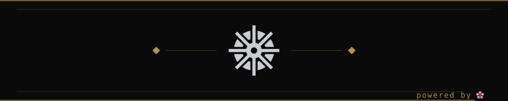

<p align="center">
  
</p>

<h1 align="center">BASE/RF</h1>

<p align="center">
  <sub>Manual de campo y programa de formación para ingenieros en telecomunicaciones · QSO CERO v0.2</sub>
</p>

<p align="center">
  <a href="LICENSE-docs.md"></a>
  <a href="LICENSE"></a>
</p>

> **Nombre provisional.** Clave interna: **NQH** (*no quedar de huevón*), que es literalmente el criterio de aceptación del programa.

**Estado:** v0.1 del programa + **v0.2 de QSO CERO** — concepto, digesto normativo chileno, mapa de competencias, laboratorio inicial, checklists y juego de Morse. Repositorio público, con doble licencia: contenido CC BY-SA 4.0, código MIT.

---

## Qué es

Un programa de formación y un manual de campo para ingenieros en telecomunicaciones **ya egresados** que quieren una base sólida y demostrable de lo que significa ser "ingeniero" en el dominio de las radiocomunicaciones. El punto de entrada es la normativa chilena de radioaficionados; el punto de salida no es la licencia, sino la capacidad de **predecir, medir, explicar y responder** por un sistema de radio real.

No enseña teoría de grado. Enseña lo que cambia una decisión: qué banda, qué potencia, qué antena, qué cable, qué hacer cuando algo interfiere, qué decir y qué no decir frente a la autoridad.

## La tesis en tres líneas

1. Un egresado tiene un título; un profesional tiene una **distinción verificable**.
2. La distinción no es saber más fórmulas: es poder **anticipar** un resultado, **medirlo**, **explicar la diferencia** y **responder** por ella.
3. La radioafición es el único laboratorio legal, barato y con consecuencias reales donde ese ciclo completo se puede practicar solo, sin clientes y sin presupuesto.

## Qué produce

| Artefacto | Para qué |
|---|---|
| Digesto normativo chileno | Saber qué está permitido, qué te expone y qué cambió |
| Mapa de competencias (6 ejes × 4 niveles) | Saber en qué nivel estás y qué te falta para subir |
| Laboratorio de 10 prácticas | Convertir conceptos en mediciones con evidencia |
| **Juego QSO CERO** | Practicar Morse de supervivencia con audio y tecleo real, sin consecuencias legales |
| Checklists de operación | No fallar bajo presión ni con testigos |
| Matemática de bolsillo | Defender números en una conversación técnica |
| Decisiones de diseño (ADR) | Que el proyecto no se degrade a curso teórico |

## Cómo se usa

- **Ruta 2 horas:** `docs/01-normativa-cl-2026.md` + `docs/04-checklists.md`. Sirve para no violar la norma esta semana.
- **Ruta 2 semanas:** agrega `docs/02-competencias.md` y los labs 0–3 de `docs/03-labs.md`.
- **Ruta 3 meses:** programa completo, con las 10 prácticas, la prueba NQH y una red de emergencia operada.
- **Ruta Morse:** abre `game/index.html` y haz 10 minutos diarios. v0.2 incluye Farnsworth configurable, niveles Koch (8), puntaje de gaps y certificado exportable. Diseño y decisiones en `docs/08-juego-morse.md`.

## Mapa del repositorio

```
README.md
AGENTS.md                      reglas para mantener el proyecto (fuentes, estilo, verificación)
LICENSE                        licencia del código (MIT)
LICENSE-docs.md                licencia del contenido (CC BY-SA 4.0)
assets/
  logo.svg                     marca original, negro sobre transparente
  logo-amber.svg               la misma marca en el ámbar del proyecto
docs/
  00-concepto.md               tesis, arquitectura, formas posibles, métricas, riesgos
  01-normativa-cl-2026.md      digesto táctico de la norma chilena vigente
  02-competencias.md           6 ejes, 4 niveles, prueba NQH
  03-labs.md                   10 prácticas con predicción, medición y evidencia
  04-checklists.md             pre-transmisión, auditoría, interferencia, emergencia, examen, compra, distintivo/repetidora
  05-matematica-de-bolsillo.md dB, enlace, Fresnel, ruido, ROE, PEP
  06-decisiones.md             ADRs: por qué Chile, por qué práctico, licencia, qué se excluye
  07-fuentes.md                normas, IDs, fechas, estado de verificación
  08-juego-morse.md            diseño de QSO CERO: modos, puntaje, arquitectura, roadmap
  09-plan-v0.2.md              plan ejecutado por workers y registro de verificación
  10-qa-v0.2.md                QA automático de v0.2, casos borde y riesgos residuales
game/
  index.html                   abre el juego (sin build, sin dependencias)
  morse-core.js                núcleo de Morse: puro, sin DOM, ejecutable en Node
  app.js                       interfaz: tecleo, puntaje, certificado, autopruebas
  audio.js                     síntesis de tono y reproducción
  curriculum.js                palabras, frases, progresión
  styles.css                   tema oscuro y layout
  test-core.mjs                pruebas del núcleo: node game/test-core.mjs
  README.md                    cómo jugar, controles, pruebas
```

## Cómo se construyó

El proyecto se mantiene con el ciclo ODD (*Organic Driven Development*): explorar antes de escribir, una tarea por unidad, workers acotados por superficie de edición, verificación y commits de un solo tema.

El registro es parte del repositorio, no de una conversación privada:

- `docs/09-plan-v0.2.md` — qué worker hizo qué, con qué modelo y con qué resultado.
- `docs/10-qa-v0.2.md` — autopruebas, casos borde y riesgos residuales.

## Cómo contribuir

1. Abre un issue con el documento, el laboratorio o la prueba que toca. Si es normativo, trae la fuente.
2. Lee `AGENTS.md` antes de editar: esas reglas de fuentes, números y estilo son parte de la revisión.
3. Si tocas el núcleo del juego, `node game/test-core.mjs` tiene que quedar en verde y la prueba nueva va junto con la tabla, el prosigno o la regla.
4. Pull request contra `main`, pequeño y de un solo tema. Al enviarlo aceptas que entra bajo la misma licencia del archivo que toca.

## Licencia

Doble licencia, por tipo de artefacto:

| Artefacto | Licencia | Archivo |
|---|---|---|
| Contenido: `README.md`, `AGENTS.md`, `docs/`, `game/README.md`, textos de la interfaz | **CC BY-SA 4.0** | `LICENSE-docs.md` |
| Código: `game/*.js`, `game/*.css`, `game/index.html` | **MIT** | `LICENSE` |

- **En corto:** el manual se puede copiar, adaptar y enseñar, siempre que se atribuya el origen y la adaptación se publique con la misma licencia. El código del juego se puede reutilizar sin arrastrar la licencia del manual.
- **Normas citadas:** la Ley 18.168, el DS 523 y el resto de las fuentes son públicas y se **referencian**, no se relicencian. Ver `docs/07-fuentes.md`.
- **Marca gráfica:** el logo de `assets/` no está cubierto por ninguna de las dos licencias. Ver "Créditos".

## Créditos

- **Marca gráfica:** `assets/logo.svg` y `assets/logo-amber.svg` son el sello del autor de este repositorio. No se relicencia.
- **Normativa:** fuente primaria en `docs/07-fuentes.md`, con fecha de consulta y estado de verificación.

## Lo que este proyecto NO es

- No es un curso de electrónica de grado ni de teoría electromagnética.
- No es una guía de compra ni un manual de DX.
- No reemplaza la normativa oficial: la cita, la traduce y marca lo que falta verificar.
- No promete que el examen sea difícil. El examen es un banco público de 45 minutos; aprobarlo no te hace competente.
- **QSO CERO** no reemplaza el aire: es un simulador de procedimiento y timing. El contacto real sigue siendo el examen final.

## Siguiente decisión del owner

Elegir el nombre definitivo y la forma del proyecto (curso, manual, repositorio vivo, mentoría o servicio de auditoría). Ver `docs/00-concepto.md` §"Formas posibles" y `docs/06-decisiones.md`.


---

<p align="center">
  <sub><strong>motor · Gentle Shell</strong> · contenido CC BY-SA 4.0 · código MIT</sub>
</p>
